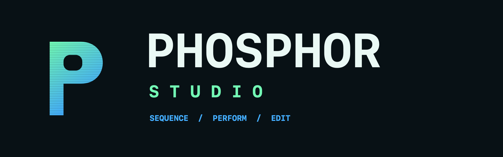

# Phosphor Studio

**Formerly known as ABJEXT.** The same video instrument and editor, with a new name. Existing projects remain readable. Preferences, shortcuts and preset libraries migrate to the new identity. MIDI routing and the optional AU identity also change; see migration notes.

  

**I wanted an Octatrack for video, so I built Phosphor Studio.**

Phosphor Studio is a native Mac video editor and performance instrument for experimental music videos, glitch art, and live visuals. Sequence footage like samples, give each hit its own effects, and let your music shape the picture. Build a precise arrangement, play clips with a MIDI controller, or set a pattern loose with probability and see where it goes.

When something works, keep it. Record your performance—including the choices made by probability and the effects you played—into an editable timeline. You can return to the details without having to recreate the moment.

The Octatrack comparison describes the approach: patterns, parameter locks, and hands-on manipulation, applied to moving images. Phosphor Studio is an independent project, not affiliated with Elektron.

**[Download Phosphor Studio](https://github.com/sxrvys/Phosphor-Studio/releases)** · **[Make your first video](docs/USER_GUIDE.md#start-here-your-first-video)** · **[User guide](docs/USER_GUIDE.md)** · **[Report an issue](https://github.com/sxrvys/Phosphor-Studio/issues)**

**Current release: 1.0.6 beta.** Developer ID signed and notarized by Apple. Built for Apple Silicon Macs running macOS 14 Sonoma or later. No account or separate development tools required.

## New to Phosphor Studio? Make your first video

Choose **Try a guided first project…** on the welcome screen. The short, hands-on walkthrough includes footage and music, so you can start experimenting straight away.

Build a layered sequence, give it clip pools and probability, add per-step effects, create a more energetic pattern variation, arrange it against the music, and turn it into an editable timeline and finished video. You learn some of Phosphor Studio’s most useful creative tools by making something with them. Hide the guide whenever you want to explore; your progress saves with the project.

**[Start the walkthrough →](docs/USER_GUIDE.md#start-here-your-first-video)**

## New in 1.0.6: Phosphor Studio

This build improves clip-editing scope, preparation and responsiveness, clearer audio/rhythmic modulation, refined CRT surfaces, imported film LUTs, timeline FX variations and rotating split-screen composition. **[Read the full changes →](CHANGELOG.md#106--phosphor-studio-formerly-known-as-abjext)**

**Updating from ABJEXT:** a migration release is available in ABJEXT’s existing **Settings → Updates** feed. Download its DMG, install **Phosphor Studio.app**, and confirm your projects open before removing the old ABJEXT app. Future updates come from this repository. Your original files remain in place. Preferences and preset libraries migrate; route external MIDI to the new Phosphor Studio port. The renamed optional AU is a new host component, so retain the previous AU for old sets or replace it manually.

## Previous release: 1.0.5

### Four sources. One dirty video mixer.

Bring in footage from the media pool, selected timeline clips, or an already-layered passage. Blend four channels at once, ride their levels with a four-way pad, and push the picture with tearing, sync roll, cross-modulation, color bleed and signal drive.

- **Change footage while playing.** Give channels their own pools; cycle backward, forward, or randomly. Use every source before repeating.
- **Punch holes in the performance.** Hold Freeze, Blackout, Invert or Damage, then release to return to your settings.
- **Recall a combination.** Save named snapshots and switch immediately or on the next project-grid beat or bar.
- **Use your hands.** Map continuous controls to MIDI CC knobs and faders.
- **Keep what happened.** Record source changes and gestures, then finish the take onto a new timeline track. Its recipe is retained and your original clips stay untouched.

Choose a lighter preview independently of final resolution. Recovery checkpoints protect unfinished takes, and failed renders can be retried. Open it from **Timeline → Dirty Video Mixer…**.

### Actual datamoshing

Let one image inherit another clip’s motion. **Timeline → Datamosh…** substitutes real compressed-video reference frames, then decodes the corruption into a stable movie you can keep using in your project.

Choose two sources, swap their roles, adjust compression and repeated re-seeding, and preview the result before committing it to a new track. This is a prepared effect, separate from the real-time Motion Corruption effect. Each render is 0.5–15 seconds at 360p or 720p; use the result as fresh material in the sequencer or timeline. Your originals stay unchanged.

### A clearer path from first pattern to export

The guided first project takes you through supplied media, beat alignment, probability, gates, FX pools, contrasting patterns, song arrangement, timeline editing and export. The walkthrough now handles duplicate pattern names correctly and gives clearer instructions for the steps that caused confusion in testing.

Clip and mask inspection, pinned controls and audio-modulation feedback make it easier to see what you’re editing. Prepared sections can recover retained originals more reliably. Cancelling an export preserves an existing destination; a failed preview soundtrack merge retains the rendered video for recovery. Project saves clean up obsolete FX wet/dry references without discarding valid recorded routing.

**[Full 1.0.5 changes →](CHANGELOG.md#105--dirty-mixer-datamosh-and-a-guided-first-project)**

**A few practical details:** the mixer records video; use timeline audio for the soundtrack. Beat/bar switching follows the project grid at four beats per bar, not external MIDI clock. Mixer takes are limited to ten minutes and live preview can hold frames under load. Datamosh respects source trim, speed and reverse; bounce first to include clip FX. Keep your source media, Renders folder and recipe/recovery sidecars with the project. New features require 1.0.5 for full replay.

## Still part of the instrument

Random FX pools, weighted clip choices, per-pattern color, prepared timeline sections, video warp markers, still-image import, MIDI control, templates and the Video Gristleizer are all here too. The new mixer and datamosh tools give you more ways to reshape that material once you’ve built it.

## Compose with footage

A glance can become a repeated phrase. A machine can land on every beat. A single shot can reveal a different moment each time it appears.

Phosphor Studio’s layered step sequencer gives you control over both the rhythm and the uncertainty:

- **Parameter locks and per-step FX:** give individual hits their own settings, effects, and saved chains.
- **Probability and weighted clip pools:** decide whether a step fires and which footage it chooses. Use every clip before reshuffling, or avoid immediate repeats.
- **Playback variation:** vary starting positions, speed, direction, and gate lengths. Let an image flash briefly, hold across steps, or give way to the next hit.
- **Layers, masks, and blending:** combine independently moving footage and shape how the layers interact.
- **Patterns and song arrangements:** develop variations for different sections, shuffle complete steps, and build longer pieces from related visual ideas.

Pool entries can have their own appearance and playback settings, so a collection of footage can stay varied without losing the treatment you gave each clip.

## Make the effects part of the music

Effects are part of the composition. Link visual parameters to bass, mids, highs, overall level, or beat-based modulation. A kick can interrupt the picture; a sustained sound can pull it into feedback; a new section can change the entire palette.

Explore temporal echoes, trails, reversals, stutters, VHS damage, film-like disruption, static, halftone, and digital corruption. The **Video Gristleizer** uses up to three interacting oscillators to create chopping, distortion, and unstable visual movement, with beat-synced or free-running modulation.

Stack effects, save chains, assign them to steps, and build macro racks for performance. Continuous FX audition lets you adjust an effect without waiting for it to come around again. Per-pattern color looks, Creative Colorizer, and Black & White / Film Noir controls give each section its own character.

Phosphor Studio’s video effects change the picture; they leave your soundtrack untouched.

## Play it, capture it, keep editing

The timeline, sequencer, and pads are connected parts of one project. Move between them as the piece takes shape.

- **Start with an edit.** Arrange and trim footage on a multitrack timeline, then turn an edit into a pattern or send excerpts into a clip pool.
- **Start with a pattern.** Prepare one section per lane and pattern pass for broader editing, keep pattern-linked sections, or choose individual cuts.
- **Start with a performance.** Trigger clips and effects with pads or MIDI, move your controls, and record the result to the timeline. Captured random choices stay fixed when you export.
- **Get the timing right.** Use the beat grid and video warp markers to bring visual action onto specific musical moments.
- **Rework your own material.** Bounce clips with their effects, then use the result as fresh footage to sequence and process again.

A MIDI controller is optional. You can build, perform, and export with a mouse or trackpad. For a moment you did not plan to record, **Keep That** can save recent processed preview history when armed; this is a preview-quality movie, separate from editable timeline recording.

## Install

You need an **Apple Silicon Mac (M1 or newer)** running **macOS 14 Sonoma or later**, plus your own video and audio files. Check individual release notes for any newer requirements.

1. Open **[Releases](https://github.com/sxrvys/Phosphor-Studio/releases)** and download the newest **`AppleSilicon.dmg`** from Assets. GitHub’s “Source code” archives are not the app.
2. Open the DMG and drag **Phosphor Studio.app** into **Applications**.
3. Eject the DMG and launch Phosphor Studio from Applications.

**The current public release is Developer ID signed and notarized by Apple.** macOS may ask you to confirm opening a downloaded app. An Open Anyway workaround should not be needed for this release. If macOS reports malware or a damaged application, report the exact message to **abjextstudio@gmail.com** rather than bypassing the warning.

No Terminal commands, Python, Xcode, Ableton, Max, TouchDesigner, separate codecs, or font installation are required. BlackHole is optional if you want to route live audio from another app into the visual controls; soundtrack reactivity works without it.

For updates, choose **Settings → Updates → Check for Updates** or **Phosphor Studio → Check for Updates…**. Save your project and quit the app before replacing it. Updates are manual and optional. [Installation and update details →](docs/USER_GUIDE.md#stay-current)

## Your first session

Start with **Try a guided first project…** on the welcome screen for a hands-on introduction with supplied footage and music. To explore on your own, bring in a song and a few clips, set the project tempo, and put a clip on a sequencer step. Add a few more hits, try a parameter lock, then introduce probability or a small clip pool. Once you find a phrase you like, record it or add it to the timeline and build the next section around it.

**[Follow the first-video walkthrough →](docs/USER_GUIDE.md#start-here-your-first-video)**

The guide covers [the workspace](docs/USER_GUIDE.md#unified-workspace), [effects and modulation](docs/USER_GUIDE.md#effects-and-video-synthesis), [timing and warp markers](docs/USER_GUIDE.md#align-music-and-video-precisely), [keyboard shortcuts](docs/USER_GUIDE.md#default-shortcuts), and [troubleshooting](docs/USER_GUIDE.md#if-something-seems-wrong).

Projects reference your original media rather than packing it into the project file. Keep those files available, and include them when sharing a project. Phosphor Studio is still in beta; save copies of important projects before trying a new release.

## Also included: Global Thermonuclear War

The download includes an optional **Audio Unit effect for your DAW**: Global Thermonuclear War. It combines five repeat engines, shuffle and reverse, a three-oscillator Gristleizer, saturation, wavefolding, chopping, and CD skips.

It is a separate audio plug-in, installed separately, and is not required for Phosphor Studio. **[Installation and host details →](docs/USER_GUIDE.md#optional-bonus-global-thermonuclear-war)**

## Help shape Phosphor Studio

I built Phosphor Studio to make videos for my own music. I’m interested in what happens when other artists bring their footage, habits, and ideas to it.

Tell me what works, what gets in your way, and what you expected to happen. Confusing controls and awkward workflows are useful feedback, too. If you make something with Phosphor Studio, I’d love to see it.

**[Open an issue](https://github.com/sxrvys/Phosphor-Studio/issues)** or email **abjextstudio@gmail.com**. For bugs, include your Mac model, macOS version, Phosphor Studio version, and the steps that reproduce the problem. Screenshots or short recordings help.

---

[Release history](CHANGELOG.md) · [Moving from Semiotic](docs/USER_GUIDE.md#moving-from-semiotic-to-abjext)

This repository hosts installers, release notes, and documentation. Application source is maintained separately. Existing Semiotic projects, presets, preferences, and MIDI mappings remain compatible; see the migration guide before removing an older installation.
