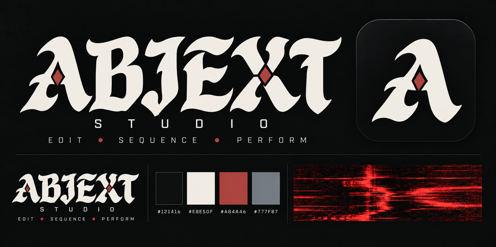

# ABJEXT Studio

  

**I wanted an Octatrack for video, so I built ABJEXT.**

ABJEXT is a native Mac video editor and performance instrument for experimental music videos, glitch art, and live visuals. Sequence footage like samples, give each hit its own effects, and let your music shape the picture. Build a precise arrangement, play clips with a MIDI controller, or set a pattern loose with probability and see where it goes.

When something works, keep it. Record your performance—including the choices made by probability and the effects you played—into an editable timeline. You can return to the details without having to recreate the moment.

The Octatrack comparison describes the approach: patterns, parameter locks, and hands-on manipulation, applied to moving images. ABJEXT is an independent project, not affiliated with Elektron.

**[Download ABJEXT](https://github.com/sxrvys/Abjext/releases)** · **[Make your first video](docs/USER_GUIDE.md#start-here-your-first-video)** · **[User guide](docs/USER_GUIDE.md)** · **[Report an issue](https://github.com/sxrvys/Abjext/issues)**

**Current release: 1.0.3 beta.** Developer ID signed and notarized by Apple. Built for Apple Silicon Macs running macOS 14 Sonoma or later. No account or separate development tools required.

## New in 1.0.3

**More dependable sideways scrolling.** Horizontal trackpad gestures now move the timeline and step sequencer directly. The timeline reuses its visible drawing area during small scrolls, and manual navigation pauses playhead-follow so the view stays where you move it. Lane headers avoid unnecessary layout work.

Includes all 1.0.2 improvements below. Project format remains unchanged. [Release details →](CHANGELOG.md#103--trackpad-scrolling)

## Included from 1.0.2

**Edit sections, not thousands of tiny hits.** Add to Timeline now defaults to **Prepared sections**: one section per video lane for each pattern pass, with optional bar divisions. Move, trim, copy and warp these larger pieces. Right-click **Show original cuts** to reopen the detail of just one section. Initial preparation renders new media once; keep the project's Renders folder with it.

**A more responsive timeline.** Dense overviews draw compact clips together, lane headers stay pinned, and edits reuse unchanged media and playback state. Command-J replaces cuts on their existing lanes. Paste uses the chosen lane and position, supports overwriting neighbors, and can be undone. Warp markers stay inside the clip. Reverse export avoids repeated frame seeks.

**See the color story.** The **Pattern Color Board** compares representative stills across patterns. Edit a whole pattern's look, copy it to another pattern, and rename patterns in place. Linked timeline color ranges update without rewriting your cuts.

**Arrange against the song.** Fractional pattern passes and **From / To** marker choices fit sections to your soundtrack. Explicit Pattern / Song arrangement preview modes and scrollable controls make the workflow easier to follow. FX menus are grouped into families.

Includes all 1.0.1 reception effects, palette controls and pool preparation tools. Older projects open normally; new saves use **format 33 and require 1.0.2 or newer**. Keep a backup if you need to return to an older app. Existing timelines are not automatically consolidated. [Release details →](CHANGELOG.md#102--timeline-sections-and-pattern-workflow)

## Compose with footage

A glance can become a repeated phrase. A machine can land on every beat. A single shot can reveal a different moment each time it appears.

ABJEXT’s layered step sequencer gives you control over both the rhythm and the uncertainty:

- **Parameter locks and per-step FX:** give individual hits their own settings, effects, and saved chains.
- **Probability and weighted clip pools:** decide whether a step fires and which footage it chooses. Use every clip before reshuffling, or avoid immediate repeats.
- **Playback variation:** vary starting positions, speed, direction, and gate lengths. Let an image flash briefly, hold across steps, or give way to the next hit.
- **Layers, masks, and blending:** combine independently moving footage and shape how the layers interact.
- **Patterns and song arrangements:** develop variations for different sections, shuffle complete steps, and build longer pieces from related visual ideas.

Pool entries can have their own appearance and playback settings, so a collection of footage can stay varied without losing the treatment you gave each clip.

## Make the effects part of the music

Effects are part of the composition. Link visual parameters to bass, mids, highs, overall level, or beat-based modulation. A kick can interrupt the picture; a sustained sound can pull it into feedback; a new section can change the entire palette.

Explore temporal echoes, trails, reversals, stutters, VHS damage, film-like disruption, static, halftone, and digital corruption. The **Video Gristleizer** uses up to three interacting oscillators to create chopping, distortion, and unstable visual movement, with beat-synced or free-running modulation.

Stack effects, save chains, assign them to steps, and build macro racks for performance. Continuous FX audition lets you adjust an effect without waiting for it to come around again. Per-pattern color looks, Creative Colorizer, and Black & White / Film Noir controls give each section its own character.

ABJEXT’s video effects change the picture; they leave your soundtrack untouched.

## Play it, capture it, keep editing

The timeline, sequencer, and pads are connected parts of one project. Move between them as the piece takes shape.

- **Start with an edit.** Arrange and trim footage on a multitrack timeline, then turn an edit into a pattern or send excerpts into a clip pool.
- **Start with a pattern.** Prepare one section per lane and pattern pass for broader editing, keep pattern-linked sections, or choose individual cuts.
- **Start with a performance.** Trigger clips and effects with pads or MIDI, move your controls, and record the result to the timeline. Captured random choices stay fixed when you export.
- **Get the timing right.** Use the beat grid and video warp markers to bring visual action onto specific musical moments.
- **Rework your own material.** Bounce clips with their effects, then use the result as fresh footage to sequence and process again.

A MIDI controller is optional. You can build, perform, and export with a mouse or trackpad. For a moment you did not plan to record, **Keep That** can save recent processed preview history when armed; this is a preview-quality movie, separate from editable timeline recording.

## Install

You need an **Apple Silicon Mac (M1 or newer)** running **macOS 14 Sonoma or later**, plus your own video and audio files. Check individual release notes for any newer requirements.

1. Open **[Releases](https://github.com/sxrvys/Abjext/releases)** and download the newest **`AppleSilicon.dmg`** from Assets. GitHub’s “Source code” archives are not the app.
2. Open the DMG and drag **ABJEXT Studio.app** into **Applications**.
3. Eject the DMG and launch ABJEXT from Applications.

**Version 1.0.3 is Developer ID signed and notarized by Apple.** macOS may ask you to confirm opening a downloaded app. An Open Anyway workaround should not be needed for this release. If macOS reports malware or a damaged application, report the exact message to **abjextstudio@gmail.com** rather than bypassing the warning.

No Terminal commands, Python, Xcode, Ableton, Max, TouchDesigner, separate codecs, or font installation are required. BlackHole is optional if you want to route live audio from another app into the visual controls; soundtrack reactivity works without it.

For updates, choose **Settings → Updates → Check for Updates** or **ABJEXT Studio → Check for Updates…**. Save your project and quit the app before replacing it. Updates are manual and optional. [Installation and update details →](docs/USER_GUIDE.md#stay-current)

## Your first session

Bring in a song and a few clips, set the project tempo, and put a clip on a sequencer step. Add a few more hits, try a parameter lock, then introduce probability or a small clip pool. Once you find a phrase you like, record it or add it to the timeline and build the next section around it.

**[Follow the first-video walkthrough →](docs/USER_GUIDE.md#start-here-your-first-video)**

The guide covers [the workspace](docs/USER_GUIDE.md#unified-workspace), [effects and modulation](docs/USER_GUIDE.md#effects-and-video-synthesis), [timing and warp markers](docs/USER_GUIDE.md#align-music-and-video-precisely), [keyboard shortcuts](docs/USER_GUIDE.md#default-shortcuts), and [troubleshooting](docs/USER_GUIDE.md#if-something-seems-wrong).

Projects reference your original media rather than packing it into the project file. Keep those files available, and include them when sharing a project. ABJEXT is still in beta; save copies of important projects before trying a new release.

## Also included: Global Thermonuclear War

The 1.0.0 download includes an optional **Audio Unit effect for your DAW**: Global Thermonuclear War. It combines five repeat engines, shuffle and reverse, a three-oscillator Gristleizer, saturation, wavefolding, chopping, and CD skips.

It is a separate audio plug-in, installed separately, and is not required for ABJEXT. **[Installation and host details →](docs/USER_GUIDE.md#optional-bonus-global-thermonuclear-war)**

## Help shape ABJEXT

I built ABJEXT to make videos for my own music. I’m interested in what happens when other artists bring their footage, habits, and ideas to it.

Tell me what works, what gets in your way, and what you expected to happen. Confusing controls and awkward workflows are useful feedback, too. If you make something with ABJEXT, I’d love to see it.

**[Open an issue](https://github.com/sxrvys/Abjext/issues)** or email **abjextstudio@gmail.com**. For bugs, include your Mac model, macOS version, ABJEXT version, and the steps that reproduce the problem. Screenshots or short recordings help.

---

[Release history](CHANGELOG.md) · [Moving from Semiotic](docs/USER_GUIDE.md#moving-from-semiotic-to-abjext)

This repository hosts installers, release notes, and documentation. Application source is maintained separately. Existing Semiotic projects, presets, preferences, and MIDI mappings remain compatible; see the migration guide before removing an older installation.
